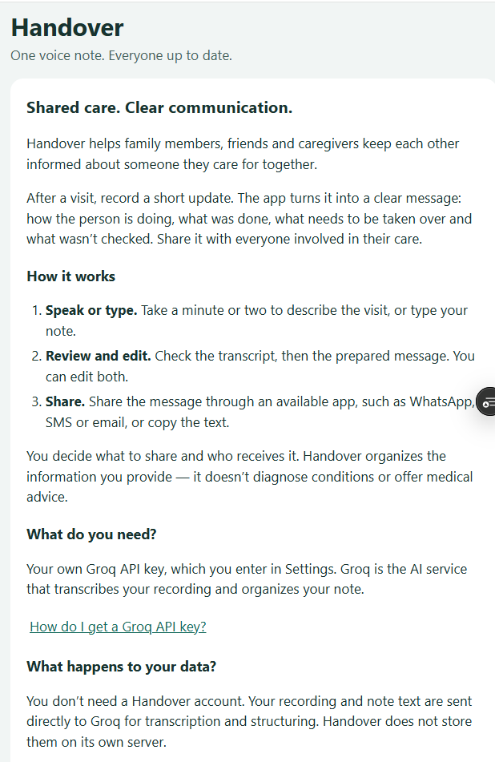
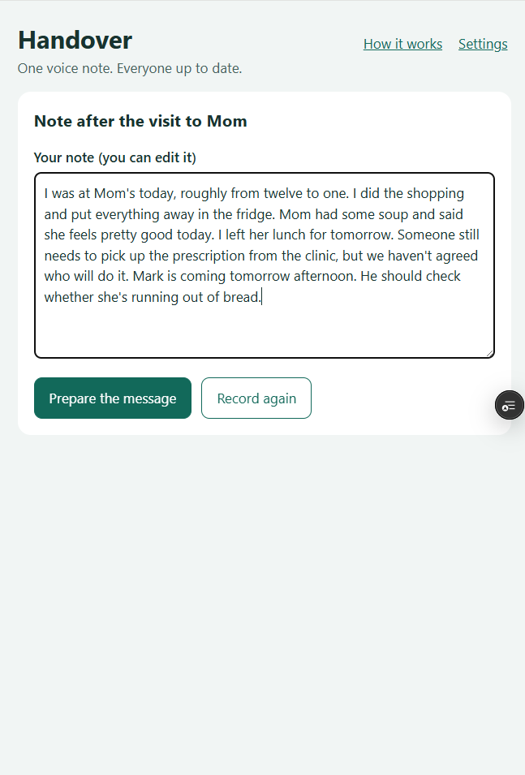
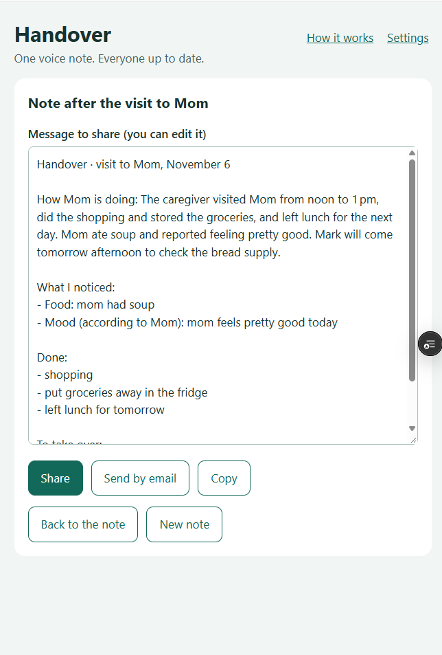

# Handover

> **One voice note. Everyone up to date.**

Handover is a PWA for people who share someone's care — family members, friends and caregivers.
After a visit, the caregiver records a short voice note and the app turns it into a structured message
for everyone else involved — how the person is doing, what was done, what the next person takes over
and what was not checked — ready to share with a single tap.

It started with adult siblings taking turns looking after an aging parent, where news from each visit
easily gets lost between them — still the case Handover is designed around first.

**Try it:** [handover-mtubis.vercel.app](https://handover-mtubis.vercel.app) — on a phone, in Chrome
or Safari. You need a free [Groq API key](https://console.groq.com/keys); the app explains how to
get one.

> Handover is not a medical device. It organizes what the caregiver said and does not assess anyone's
> health.

<p align="center">
  
  
  
</p>

The UI is available in English, Polish and German: it follows the browser's language,
falls back to English, and can be changed in Settings. The note is transcribed and the message is
written in the same language. Scope: [`SPEC.md`](SPEC.md). Rationale: [`DECISIONS.md`](DECISIONS.md).

## How it works

0. **Welcome (first visit):** what the app is for and how to use it; reopened via "How it works".
1. **Settings (once):** the language, a Groq API key, how you refer to the person you care for (e.g. "Mom";
   left empty, a default for the language is used) and optional email recipients.
2. **Record** a voice note (or type it).
3. **Transcribe** with `whisper-large-v3-turbo` in the selected language; the transcript is editable.
4. **Prepare the message:** `openai/gpt-oss-120b` returns JSON (strict schema), which is validated and
   formatted into a handover message in the selected language; the message is editable.
5. **Share** via the Web Share API (WhatsApp, SMS, …) when available, or send it by email (a `mailto:`
   link with the default recipients from settings), or copy it to the clipboard.

## Privacy

- No backend, no database, no analytics, no history of notes. Only the note in progress is kept on
  the device (text in `localStorage`, the recording in IndexedDB until it is transcribed), so a
  reload doesn't lose it. It is deleted when a new note is started, on "Delete draft", or after
  24 hours without changes.
- The only network traffic with note content is the call to the Groq API. According to
  [Groq's data policy](https://console.groq.com/docs/your-data), inference data is not retained by
  default, but may be logged for up to 30 days to troubleshoot errors or investigate abuse; Groq
  stores data in the USA. The in-app "Privacy" section in Settings says the same to users.
- The API key is stored in `localStorage` on the device. This fits the bring-your-own-key model;
  a version with shared access would call the AI through a backend with a server-side key.
- Settings and a flag that the welcome screen was seen are stored in `localStorage` as well.
- The app does not diagnose anything: the prompt forbids medical interpretation, recommendations,
  urgency assessment and invented people or dates.

## Running locally

Requires Node.js 20.19+.

```bash
npm install
npm run dev        # http://localhost:5173 — the microphone works on localhost
```

Phone testing needs HTTPS (microphone, Web Share), so it is done on Vercel: production deploys from
`main`, and every other branch gets a preview deployment.

## Scripts

| Command | What it does |
|---|---|
| `npm run dev` | Vite dev server |
| `npm run build` | Type-check and production build (with the PWA service worker) |
| `npm run typecheck` | TypeScript (strict) |
| `npm run lint` | oxlint |
| `npm test` | Vitest + React Testing Library (jsdom) |

## Project layout

```
src/ai/          provider layer: config (model IDs), Groq calls, prompt + JSON schema, response type guard
src/i18n/        UI strings per language, typed against one Messages interface; useT() hook
src/lib/         pure functions and storage: message formatting, mailto:, audio MIME helpers, error
                 mapping, settings, the on-device draft (localStorage + IndexedDB)
src/components/  welcome, settings + key help + privacy, recorder (+ MediaRecorder hook), message
                 preview, share actions, draft notice
fixtures/        sample transcripts in PL/EN/DE (audio is git-ignored)
spikes/          Groq browser test done before implementation, not part of the app
```

## Tests

- Unit tests for pure logic: LLM response parsing, message formatting in all three languages
  (empty sections omitted, owners, negations under "Not checked"), `mailto:` encoding, audio file
  naming, error messages, locale detection, settings, the draft and its expiry, the prompt.
- React Testing Library tests with the AI layer mocked: the first visit and the API key, the key
  help and privacy section, the UI and message language, sharing the edited message and the
  `mailto:` / copy fallback, retrying a failed transcription, restoring and deleting the draft.
- Not covered automatically: `MediaRecorder`, IndexedDB, real AI calls, cross-browser behavior —
  verified manually on Android and iOS phones.

## Known limitations

- Self-corrections in speech are not always resolved: for "Thursday at 10, no, at 11" the model put
  the visit time under "Not checked" instead of using 11. The message is editable before sending.
- Long notes may exceed the response limit; the user gets a readable error.
- A recording interrupted mid-capture (e.g. the browser kills the tab while recording) is lost;
  only finished recordings are kept until they are transcribed.

## What I'd do next

- **Demo mode:** a sample note and message without an API key, so the result can be seen in a
  minute, without signing up anywhere.
- **Shared access without a personal key:** a small backend holding the provider key, with rate
  limiting — the point where a server starts to pay off.
- **Better handling of self-corrections** in speech, checked against a small prompt evaluation set
  built from the fixtures.
- **Broader tests:** full user-flow tests, MSW for the HTTP layer, accessibility checks and a
  Playwright happy path on real browser engines.
- More languages: the dictionaries are typed against one interface, so a new one is a single file.

## License

[MIT](LICENSE) © 2026 Magdalena Tubis
